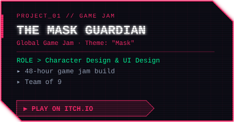
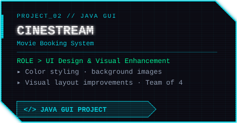

<div align="center">



<a href="https://git.io/typing-svg">
  
</a>

<br/>





</div>

## 〔 01 〕 // ABOUT_ME

> I'm a **Diploma in Computer Science** student at **New Era University College** with a **CGPA of 3.83**.
>
> I have a strong interest in **UI Design and Visual Presentation** — especially **interface layouts, color combinations, and visual styling**.
>
> Through academic projects and collaborative activities, I've gained experience in **improving application interfaces** and **designing game UI elements**. My programming background helps me understand the **technical side of interface development**.

<div align="center"></div>

## 〔 02 〕 // EDUCATION

<div align="center">

| 🏫 INSTITUTION | 📘 PROGRAMME | 📅 PERIOD | 🏆 CGPA |
|:---:|:---:|:---:|:---:|
| **New Era University College** | Diploma in Computer Science | 2025 – 2027 | **3.83** |

</div>

<div align="center"></div>

## 〔 03 〕 // SKILL_MODULES

<div align="center">

**`> programming`**


**`> tools`**


<br/>


-F9F002?style=for-the-badge&labelColor=05070d)

</div>

<div align="center"></div>

## 〔 04 〕 // SELECTED_PROJECTS

<div align="center">
<table>
<tr>
<td align="center">
<a href="https://metagenteyben.itch.io/the-mask-guardian">

</a>
</td>
<td align="center">

</td>
</tr>
</table>

<sub>▸ Click <b>The Mask Guardian</b> to play it on itch.io</sub>

</div>

<div align="center"></div>

## 〔 05 〕 // SYSTEM_STATS

<div align="center">


</div>

<div align="center"></div>

## 〔 06 〕 // CONTACT

<div align="center">

[](mailto:yeowzongzheng@gmail.com)
[](https://metagenteyben.itch.io/the-mask-guardian)

<br/>

```
> Thank you for visiting my portfolio!
> Let's build something beautiful. _
```


</div>
